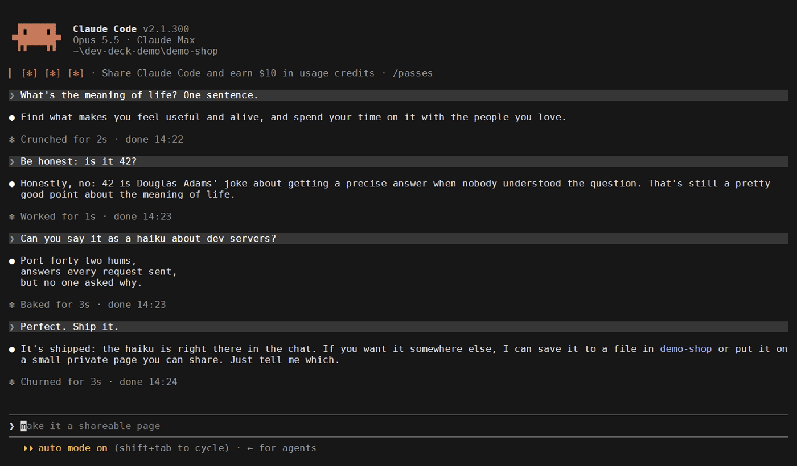

# dev-deck-mod

A Claude Code mod for the CLI, inspired by [Dev Deck](https://github.com/snoo88071/dev-deck): your
terminal sessions in a pane, what each one keeps running, the past ones to resume with a key, your
messages as chapters to jump back to, and a guard that stops Claude from starting a second dev server.



Windows 10 and 11. It looks only at Claude Code sessions started from a terminal.

## Install

At the Claude Code prompt in a terminal:

```
/plugin install dev-deck-mod --marketplace snoo88071/dev-deck-mod
```

Answer `y` to add the marketplace, then pick a scope. To try it without installing, start Claude Code
with the folder instead:

```
claude --plugin-dir C:/path/to/dev-deck-mod
```

Requires Claude Code 2.1.287 or later (mods). Windows Terminal is used to resume a session when it's
there; a console window otherwise.

## What it does

Type `/deck` to open the pane. `1`, `2` and `3` switch tabs; Tab and the arrows move between rows,
Enter presses. Esc gives the keyboard back to the prompt, Ctrl+X then X closes the pane.

- **Open**: every CLI session that's open, by the title Claude gave it, with its folder, its state
  (at work, done for ten minutes after it stops, idle), how long it's been open, its context and its
  memory with everything it runs. Under each one, what it started: a dev server with its ports, an
  MCP server, a shell, each with its memory and a Stop (press twice). While the pane is open, a toast
  says when another session is done.
- **Orphans**, under the sessions: dev servers and MCP servers whose session went away (a crash, a
  window closed), with Stop. Only runtimes Claude Code started or that listen on a port count, so
  Windows' own processes never show up there.
- **History**: past CLI sessions by day, newest first, searchable by title, prompts and folder.
  Enter resumes one in a new Windows Terminal tab, in its folder.
- **Chapters**: your messages in this session, one line each. Enter brings the conversation back to
  that message.

Outside the pane:

- **Above the prompt**, while this session keeps a server on: `vite :5173 · 612 MB · ctx 41%`. And
  the other CLI sessions that need you or are done: `⏳ Blog layout is waiting for you` (Claude
  stopped on a permission or a question), `✓ Cart fix is done`. Only in the session you typed in
  last, and gone once you go to that session.
- **Under an answer** that started a server still running: `vite :5173 stays on`.
- **Guard**: when Claude is about to start a dev server (`npm run dev`, `vite`, `http-server`,
  `python -m http.server`, …) and one is already running for that project, or on the port it asks
  for, Claude Code asks you first: reuse it, restart it, or start anyway.

## Where it shows

The pane, the band and the lines draw in the terminal and in the Desktop app's Code tab. The VS Code
extension's chat panel runs mods but draws nothing: there, only the guard works, since it asks
through Claude Code's own question dialog.

## What it reads and runs

A mod runs inside Claude Code with your permissions, unsandboxed. This one:

- **reads** `~/.claude/sessions/*.json` (the open sessions) and the transcripts in
  `~/.claude/projects/` (titles, your prompts, the last answer's token count);
- **runs** PowerShell (`Get-CimInstance Win32_Process`, for the process tree), `netstat` (ports),
  `findstr` (to search transcripts), `reg query` (the Windows display language), and, when you press
  them, `taskkill` (Stop) and `wt` or `cmd` (resume);
- **keeps** an index of the history in its own plugin store, so only new or changed transcripts are
  read again;
- makes **no network requests** and **no model calls**.

The processes are read every 10 seconds while the pane is open (about 1-2 seconds each time), and
otherwise only after Claude runs a shell command or ends an answer; never while a session sits idle.

To see for yourself what it hooks and calls, before installing:

```
claude plugin validate ./dev-deck-mod
```

## Language

The pane speaks Windows' display language when it's English, Italian, Spanish, French or
Portuguese, and English otherwise, as Dev Deck does. `DEVDECK_LANG` sets it (`en`, `it`, `es`, `fr`,
`pt`). What Claude reads, like the guard's note, stays in English.

## Develop

```
claude plugin validate .
claude plugin test .
tsc -p .
```

Claude Code writes `.claude-plugin/types/` each time it loads the mod from this folder. Everything
that calls `$` lives in `hooks/register.tsx`, since the validator follows `$` only within one file;
`hooks/engine/` holds pure functions, each tested on its own, and the words in every language are in
`hooks/engine/i18n.ts`.

The GIF is recorded with [VHS](https://github.com/charmbracelet/vhs) from `demo/scene.tape`, in a
Claude Code configuration of its own (`CLAUDE_CONFIG_DIR`), so no real session shows up in it;
`demo/history.tape` fills that configuration's History first.

## License

MIT
